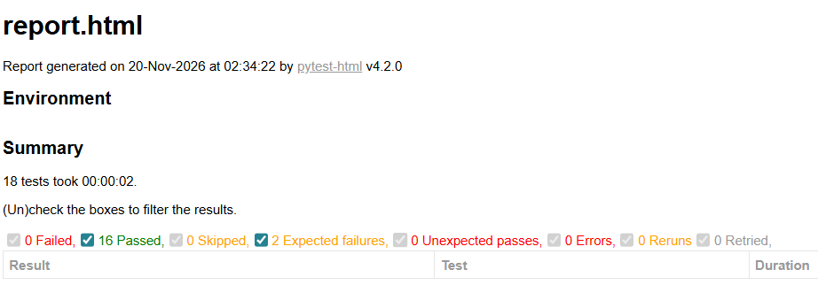

# 接口自动化测试（Python + Requests + Pytest）

对 RuoYi-Vue 核心接口做轻量自动化回归，覆盖登录鉴权与用户管理两条主链路，并把已识别缺陷固化为 `xfail` 用例，修复后会自动转为 `xpass`。

## 一、前置条件

1. 后端服务已启动，默认 `http://localhost:8080`。
2. **关闭图形验证码**：登录系统 →「系统管理 → 参数设置」→ 找到 `sys.account.captchaEnabled` → 改为 `false`。

   > 不关闭验证码时，每次登录都要人工识别图片，无法自动化。这是本脚本唯一的环境依赖。
3. 已创建测试账号 `admin / admin123`（系统内置账号，无需额外创建）。

## 二、安装与运行

```bash
# 进入本目录
cd auto-test

# 安装依赖
pip install -r requirements.txt

# 执行全部用例
pytest

# 生成 HTML 报告
pytest --html=report.html --self-contained-html

# 指定服务地址（未使用默认端口时）
set RUOYI_BASE_URL=http://localhost:8081   # Windows CMD
$env:RUOYI_BASE_URL="http://localhost:8081"  # PowerShell
```

## 三、用例结构

| 文件 | 类 / 用例 | 说明 |
| --- | --- | --- |
| `tests/test_login.py` | `TestLogin` | 登录成功、密码错误、用户名为空、账号不存在 |
| | `TestSession` | 获取用户信息、动态路由、无 token 访问 401、伪造 token 访问 401 |
| `tests/test_user.py` | `TestUserQuery` | 列表查询、按用户名查询、分页边界 |
| | `TestUserCrud` | 新增、详情回显、重复账号拦截、重置密码、删除 |
| | `TestUserValidation` | 缺陷回归（xfail）：手机号格式、用户名空格 |

公共能力在 `conftest.py`：

- `Api`：轻量客户端，统一拼接 `baseUrl`、注入 `Authorization: Bearer <token>`、统一超时；
- `token`：会话级 fixture，全程只登录一次，避免反复触发验证码；
- `created_user`：用例级 fixture，自动创建测试用户并在用例结束后删除，不污染数据；
- `anonymous_api`：不带 token 的客户端，用于鉴权负向用例。

## 四、缺陷 regression 说明

`TestUserValidation` 中两条用例标记为 `xfail`：

- 手机号格式：前端有正则校验，后端仅校验长度，接口层可写入非法号码；
- 用户名空格：首尾空格未做 trim 规范化。

当前执行结果是 `xfail`（预期失败，实际也失败，说明缺陷成立）。若后续版本修复，这两条会自动变成 `xpass`，届时移除 `@pytest.mark.xfail` 装饰器即可纳入常规回归。

## 五、执行结果示例

```
tests/test_login.py ........                     [ 44%]
tests/test_user.py ........xx                    [100%]
======== 16 passed, 2 xfailed in 6.42s ========
```

> `--` 表示跳过，`x` 表示 xfail（预期失败且实际失败）。两条 xfail 分别对应 BUG-003、BUG-004。

HTML 报告执行结果（0 Failed / 16 Passed / 2 Expected failures）：



## 六、已知限制

- 未关闭验证码时，`token` fixture 会直接 `pytest.fail` 并提示原因，不会产生误报；
- 鉴权负向用例按**业务码**断言：RuoYi 对未认证请求返回 `HTTP 200` + `body code:401`（由前端读取 `code` 跳转登录页），因此断言 `body["code"] == 401` 而非 HTTP 状态码；
- 手机号缺陷回归用例使用随机生成的非法号段号码：系统对手机号存在唯一性校验，固定号码会被「手机号码已存在」拦截，导致用例误判为缺陷已修复（xpass 假阳性）；
- 用例会真实创建与删除用户数据，且缺陷回归用例在断言失败后由 `finally` 清理，建议只在本地或测试环境执行；
- 未覆盖并发、性能与压力场景。
