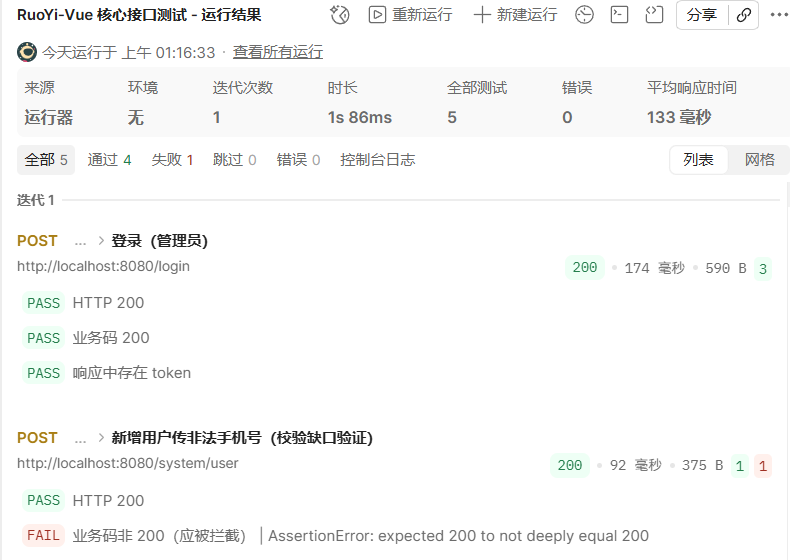
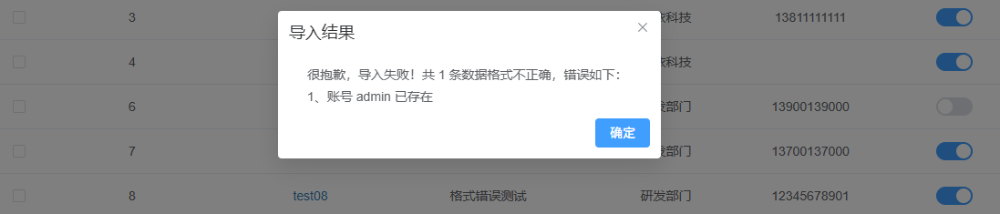

# 缺陷清单

| 项 | 内容 |
| --- | --- |
| 被测系统 | RuoYi-Vue 后台管理系统 v3.9.2（本地部署） |
| 测试类型 | 黑盒功能测试 / 权限校验专项 / 接口层校验 |
| 缺陷总数 | 9 条（一般 6、建议 3、致命与严重 0） |

## 一、说明

**严重程度定义**

- 致命：系统不可用、数据丢失、核心数据错乱
- 严重：核心流程阻塞、安全机制缺失、权限失效
- 一般：功能异常但存在替代路径，影响范围可控
- 建议：体验优化或安全加固类，不影响主流程

**验证状态定义**

- 已复现：已按所列步骤在本地环境稳定复现，实际结果已记录
- 待验证：测试中识别出的风险点，复现思路已写明，实测结论待补充

> 本轮 **9 条缺陷全部为实测复现**，无推测条目。未发现致命级与严重级缺陷，业务逻辑层的保护校验（删除被引用数据、名称唯一性、超管保护、当前用户删除拦截）均有效，问题集中在**前后端校验一致性**与**安全加固**两类。

## 二、缺陷总览

| 缺陷 ID | 所属模块 | 缺陷标题 | 严重程度 | 验证状态 | 关联用例 |
| --- | --- | --- | --- | --- | --- |
| BUG-001 | 登录模块 | 同一浏览器多标签页登录不同账号时，后登录账号覆盖前一个账号的登录态 | 一般 | 已复现 | LOGIN-014 |
| BUG-002 | 用户管理 | 新增用户密码仅校验长度，无字符类型要求，可设置 `123456` 纯数字弱口令 | 建议 | 已复现 | USER-012 |
| BUG-003 | 用户管理 | 手机号格式仅由前端校验，后端仅校验长度，表单与导入两条通道均可提交非法规格 | 一般 | 已复现 | Postman「新增用户传非法手机号」、USER-025 导入复测 |
| BUG-004 | 用户管理 | 用户名称首尾空格未做规范化处理，账号创建后实际无法登录 | 一般 | 已复现 | USER-011 |
| BUG-005 | 用户管理 | 归属部门非必填，可创建无部门归属的孤儿用户 | 一般 | 已复现 | USER-026 |
| BUG-006 | 部门管理 | 部门循环引用仅前端拦截，接口层可写入形成环形结构 | 一般 | 已复现 | DEPT-010 |
| BUG-007 | 字典管理 | 同一字典类型下字典键值可重复，无唯一性校验 | 建议 | 已复现 | DICT-011 |
| BUG-008 | 用户管理 | 批量导入失败提示只有错误序号，不含 Excel 行号，无法定位问题行 | 建议 | 已复现 | USER-025 |
| BUG-009 | 全局 | 全局异常处理直接返回异常原文，响应中泄露 SQL 语句、服务器绝对路径与表结构 | 一般 | 已复现 | 接口异常触发（POST /system/dept 主键冲突） |

合计 9 条：一般 6 条、建议 3 条、致命与严重 0 条。

---

## 三、缺陷详情

### BUG-001 同一浏览器多标签页登录态互相覆盖

- **所属模块**：登录模块 / 会话管理
- **严重程度**：一般
- **验证状态**：已复现
- **关联用例**：LOGIN-014
- **前置条件**
  1. Chrome 浏览器已使用 `admin / admin123` 登录系统
  2. 存在受限账号 `test01 / test01`
- **复现步骤**
  1. 新建标签页，打开同一登录地址
  2. 使用 `test01` 登录成功
  3. 切回第一个标签页，按 `F5` 刷新
- **实际结果**：第一个标签页刷新后身份变为 `test01`，右上角用户名与左侧菜单均切换为 `test01` 的权限视图，原 `admin` 登录态丢失。
- **预期结果**：同一浏览器的不同标签页应能独立保持各自登录身份；若产品设计不支持多账号并存，应在第二个账号登录时给出明确提示（如「当前已登录其他账号，是否切换」），而不是静默覆盖。
- **影响**：测试人员无法在同一浏览器并行验证两个角色的权限差异，容易误判权限测试结果；普通用户侧表现为「刷新后莫名其妙换了个人」。
- **规避方式**：使用两个浏览器（Chrome + Edge），或同一浏览器的普通窗口 + 无痕窗口分别登录。
- **修复建议**：登录态按标签页隔离存储（sessionStorage），或检测到已有其他账号会话时提示用户确认切换。

---

### BUG-002 新增用户密码仅校验长度，无字符类型要求

- **所属模块**：用户管理
- **严重程度**：建议
- **验证状态**：已复现
- **关联用例**：USER-012
- **前置条件**
  1. `admin` 已登录系统
- **复现步骤**
  1. 进入「系统管理 → 用户管理」，点击「新增」
  2. 用户名称填测试账号，密码与确认密码均填 `12345`
  3. 点击「确定」，观察提示
  4. 改为填 `123456`（6 位纯数字），再次点击「确定」
- **实际结果**：`12345` 被长度规则拦截，提示「密码长度必须介于 6 和 20 之间」；`123456` **保存成功**，6 位纯数字弱口令可直接入库，系统未要求字母、数字、特殊字符的组合。
- **预期结果**：密码应校验复杂度（至少包含字母与数字两类字符），纯数字或纯字母弱口令应被拒绝并提示规则；管理员重置密码、用户修改密码应遵循同一规则。
- **影响**：系统内可存在大量纯数字弱口令账号，一旦暴露在公网，被撞库/爆破成功的概率显著上升。
- **修复建议**：后端统一密码策略校验，前端同步展示规则文案，避免只在前端提示。

---

### BUG-003 手机号格式仅前端校验，后端仅校验长度

- **所属模块**：用户管理 / 接口校验
- **严重程度**：一般
- **验证状态**：已复现
- **关联用例**：Postman 集合「02 用户管理 → 新增用户传非法手机号」、USER-025 导入复测
- **前置条件**
  1. 已获取登录 token（Postman 集合中登录请求会自动回写）
  2. 已知新增用户接口 `POST /system/user` 的请求体字段
- **复现步骤（通道一：接口）**
  1. 页面上新增用户时手机号填 `12345678901`，确认前端拦截并提示格式错误
  2. 绕过前端，在 Postman 中直接调用 `POST /system/user`，`phonenumber` 传 `12345678901`（11 位但不符合号段规则）
  3. 查看接口返回，并到用户列表 / 数据库中确认该记录是否入库
- **复现步骤（通道二：Excel 导入）**
  1. 用「下载模板」取得用户导入模板，按模板列填写一行：登录名称 `test08`、手机号码 `12345678901`
  2. 通过「用户管理 → 导入」上传该文件
- **实际结果**：
  - 通道一：后端直接放行，返回 `HTTP 200` / `code: 200` / `msg: 操作成功`，用户记录入库，列表中可见手机号为 `12345678901` 的新账号。接口自动化中「业务码非 200（应被拦截）」断言因此失败，失败本身就是缺陷成立的证据。
  - 通道二：该行**导入成功**，`test08` 正常建出且手机号为 `12345678901`，说明导入通道同样未做格式校验。
  - 补充观察：Service 层其实**存在手机号唯一性校验**（新增接口重复号码会返回「手机号码已存在」），但导入通道绕过了这层校验——导入时该号码与库中已有账号重复仍能成功入库，说明 Excel 导入未复用 Service 层的校验逻辑。
- **预期结果**：后端应独立完成手机号格式校验（如 `^1[3-9]\d{9}$`），非法格式返回明确错误码，不依赖前端或导入前的界面提示。
- **影响**：前端校验可被接口层与批量导入绕过，导致脏数据入库，影响短信通知、数据统计等下游功能；属典型的前后端校验不一致问题。
- **修复建议**：在 `SysUser` 实体上增加 `@Pattern` 注解或自定义校验器，使表单、导入、接口三条路径共用同一规则；接口自动化中已固化为 `xfail` 回归用例。

**证据一：Postman 运行器（接口通道放行）**

> 图中可读出：请求 `POST http://localhost:8080/system/user`、响应状态 `200`、断言「业务码非 200（应被拦截）」失败，请求体 `phonenumber` 为 `12345678901`——长度合法、号段非法。

**证据二：Excel 导入（导入通道放行）**

> 图中上方为导入结果提示（错误行被正确拦下），下方列表中 `test08` 已建出、部门为「研发部门」、手机号为 `12345678901`，证明非法手机号通过了导入通道。

---

### BUG-004 用户名称首尾空格未做规范化处理

- **所属模块**：用户管理
- **严重程度**：一般
- **验证状态**：已复现
- **关联用例**：USER-011
- **前置条件**
  1. `admin` 已登录系统
  2. 账号 `test05` 未被占用
- **复现步骤**
  1. 进入「系统管理 → 用户管理」，点击「新增」
  2. 用户名称输入 `  test05  `（前后各两个半角空格）
  3. 其余必填项正常填写后点击「确定」
  4. 观察列表中该行的用户名称显示
  5. 退出登录，用 `test05` 登录
- **实际结果**：账号保存成功，数据库 `sys_user.user_name` 原样保存为 `  test05  `（含空格）；列表中因 HTML 空格折叠，肉眼显示为 `test05`，无法识别异常；用 `test05` 登录提示用户不存在或密码错误，**该账号实际不可用**。
- **预期结果**：保存前应对用户名做 `trim`；含空格的账号应在表单校验阶段直接拦截并提示。
- **影响**：形成「肉眼正常、实际登不进去」的隐性不可用账号，管理员难以自行排查；若同类问题出现在批量导入数据中，排查成本更高。
- **修复建议**：后端在 insert/update 前统一 `trim`，前端校验增加「不允许包含空格」规则；自动化中已固化为 `xfail` 用例。

---

### BUG-005 归属部门非必填，可创建孤儿用户

- **所属模块**：用户管理
- **严重程度**：一般
- **验证状态**：已复现
- **关联用例**：USER-026
- **前置条件**
  1. `admin` 已登录系统
- **复现步骤**
  1. 进入「系统管理 → 用户管理」，点击「新增」
  2. 用户名称、密码、昵称等必填项正常填写，**归属部门留空**
  3. 直接点击「确定」
  4. 观察列表与部门树筛选结果
- **实际结果**：用户创建成功，`dept_id` 为空；在左侧部门树中点击任意部门，该用户均不出现在结果里，只能通过「全部部门」或按用户名搜索找到。
- **预期结果**：归属部门应为必填项，留空时拦截并提示「归属部门不能为空」。
- **影响**：产生组织架构之外的数据孤岛，按部门统计人数、按部门导出、按部门数据权限过滤时均会漏掉该用户，或导致数据权限判断异常。
- **修复建议**：前端表单增加 `deptId` 必填规则，后端 insert/update 增加非空校验，历史数据补一次归属部门清洗。

---

### BUG-006 部门循环引用仅前端拦截，接口层可写入环形结构

- **所属模块**：部门管理
- **严重程度**：一般
- **验证状态**：已复现
- **关联用例**：DEPT-010
- **前置条件**
  1. 已获取登录 token
  2. 已知部门 ID：`101` 深圳总公司、`103` 研发部门（研发部门为深圳总公司下级）
- **复现步骤**
  1. 页面进入「系统管理 → 部门管理」，点「深圳总公司 → 修改」，展开上级部门下拉
  2. 观察下拉选项：其自身及下级（研发、市场、测试、财务、运维部门）均不在列表中，界面无法构造循环
  3. 绕过界面，在 Postman 中调用 `PUT /system/dept`，请求体：`deptId=101`、`parentId=103`、`deptName=深圳总公司`，其余字段按原值填写
  4. 查看返回结果，并查库确认 `sys_dept.parent_id`
- **实际结果**：接口返回 `code: 200`、`msg: 操作成功`，`sys_dept.parent_id` 被更新为 `103`，形成「深圳总公司 → 研发部门 → 深圳总公司」的环形结构。
- **预期结果**：后端在 `updateDept` 中应校验目标父节点不能是自身或自身的任一后代，命中时返回业务错误。
- **影响**：部门树渲染可能出现节点丢失或递归异常；按部门统计、数据权限计算、级联操作均会失效，且属于后台很难自发发现的结构性脏数据。
- **修复建议**：`updateDept` 前判断 `parentId` 是否落在自身 `ancestors` 链中，或在修改后校验长度并回滚；界面端维持现有的「排除自身及下级」策略。
- **备注**：验证完成后已执行 `update sys_dept set parent_id = 100 where dept_id = 101;` 恢复数据。**注意只改 `parent_id` 不够**——`ancestors` 仍保留 `0,103,101` 的错误路径，导致该部门在界面的上级下拉中消失、修改页上级框显示为数字 `101`；需补执行 `update sys_dept set ancestors = '0,100' where dept_id = 101;` 才真正还原（这一条也是本次测试顺带发现的运维坑：两列必须同时修正）。

---

### BUG-007 同一字典类型下字典键值可重复

- **所属模块**：字典管理
- **严重程度**：建议
- **验证状态**：已复现
- **关联用例**：DICT-011
- **前置条件**
  1. `admin` 已登录系统
  2. 字典类型 `sys_user_sex` 下已存在键值为 `0` 的「男」
- **复现步骤**
  1. 进入「系统管理 → 字典管理」，选中字典类型「用户性别」
  2. 在「字典数据」区域点击「新增」
  3. 数据标签填 `男2`，**数据键值填 `0`**（与已有项重复），显示排序填 `11`
  4. 点击「确定」
- **实际结果**：保存成功，`sys_user_sex` 下出现两条 `dict_value = 0` 的数据项（`dictCode` 分别为 1 和 30）。
- **预期结果**：同一 `dict_type` 下 `dict_value` 应唯一，重复时拦截并提示键值已存在。
- **影响**：同一字典类型下存在两条 `dict_value = 0` 的数据，所有按值关联的逻辑（回显、条件查询、统计）都只能命中其中一条，命中哪条取决于数据顺序；用户在下拉中看到的「男2」与「男」在数据层完全等价，选择无法在库中区分。配置层脏数据会随字典复用扩散到所有引用该类型的业务。
- **修复建议**：后端 insert/update 增加 `(dict_type, dict_value)` 唯一校验，并在表上补唯一索引兜底。

---

### BUG-008 批量导入失败提示不含 Excel 行号

- **所属模块**：用户管理
- **严重程度**：建议
- **验证状态**：已复现
- **关联用例**：USER-025
- **前置条件**
  1. `admin` 已登录系统
  2. 准备一份含错误行的用户导入 Excel（其中一行登录名称与已有账号 `admin` 重复）
- **复现步骤**
  1. 「用户管理 → 导入」上传该文件
  2. 查看「导入结果」弹窗文案
- **实际结果**：提示为「很抱歉，导入失败！共 1 条数据格式不正确，错误如下：1、账号 admin 已存在」。其中「1、」是**错误条目序号**而非 Excel 行号，用户无法据此直接定位到具体行。
- **预期结果**：提示应包含 Excel 行号，如「第 2 行：账号 admin 已存在」，或输出「行号 + 原因」的列表。
- **影响**：导入几十行数据且存在多条错误时，用户只能逐行人工比对，导入效率与可用性明显下降。
- **修复建议**：导入循环中记录数据行号（对应 Excel 实际行），返回值改为 `(行号, 原因)` 结构，前端按行渲染。

---

### BUG-009 全局异常直接返回异常原文，泄露 SQL 与服务器路径

- **所属模块**：全局 / 异常处理
- **严重程度**：一般
- **验证状态**：已复现
- **关联用例**：接口异常触发（`POST /system/dept`，提交已存在的主键）
- **前置条件**
  1. 已获取登录 token
- **复现步骤**
  1. 绕过界面，在 Postman 中调用 `POST /system/dept`，请求体 `deptId` 填一个已存在的部门 ID（如 `101`）
  2. 查看响应体
- **实际结果**：返回 `code: 500`，`msg` 中包含：完整的 `insert into sys_dept(...)` SQL 语句、mapper 文件的服务器绝对路径 `D:\ruoyi\RuoYi-Vue-master\ruoyi-system\target\classes\mapper\system\SysDeptMapper.xml`、底层异常类名 `java.sql.SQLIntegrityConstraintViolationException`、以及 `sys_dept` 的全部字段名。
- **预期结果**：统一异常处理应对外返回脱敏文案（如「操作失败，请联系管理员」），异常堆栈与 SQL 明细只写入服务端日志。
- **影响**：客户端可直接获得数据库表结构、服务端目录结构与技术栈信息，为后续攻击提供便利；同时暴露内部实现细节，属信息安全层面的加固缺口。
- **修复建议**：`GlobalExceptionHandler` 中 `RuntimeException` 分支改为返回固定文案，异常详情仅 `log.error` 记录；生产环境关闭 `debug` 级错误输出。

---

## 四、缺陷分布

**按模块**

| 模块 | 数量 | 占比 |
| --- | --- | --- |
| 登录模块 | 1 | 11% |
| 用户管理 | 5 | 56% |
| 部门管理 | 1 | 11% |
| 字典管理 | 1 | 11% |
| 全局 / 异常处理 | 1 | 11% |
| 合计 | 9 | 100% |

**按严重程度**

| 严重程度 | 数量 | 占比 |
| --- | --- | --- |
| 致命 | 0 | 0% |
| 严重 | 0 | 0% |
| 一般 | 6 | 67% |
| 建议 | 3 | 33% |

**按验证状态**

| 状态 | 数量 |
| --- | --- |
| 已复现 | 9 |
| 待验证 | 0 |

> 从分布看：RuoYi-Vue 在业务逻辑层的保护校验相当完整（删除被引用数据、名称唯一性、超级管理员保护、当前用户删除拦截等用例全部通过），问题集中在**前后端校验一致性**（手机号、用户名空格、部门循环、归属部门）与**安全加固**（密码策略、异常信息脱敏）两类。这与开源项目「重功能、轻安全」的典型特征吻合，也说明本轮发现的均为中低风险改进项，而非阻塞性问题。
>
> 另：登录失败锁定一项经实测确认已内置（连续 5 次错误锁定 10 分钟），不构成缺陷，未列入清单。
